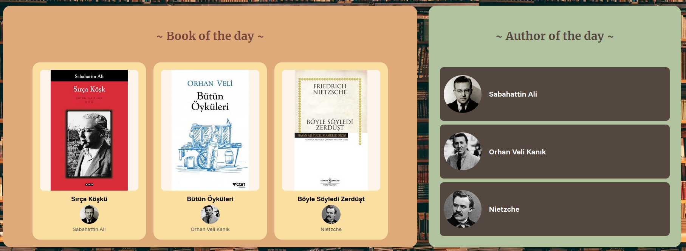
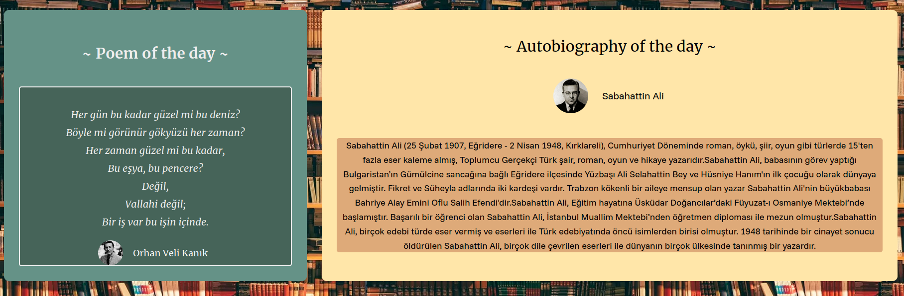

# 📚 Kitap Blogu

PHP ve MySQL ile geliştirilmiş, kullanıcıların kitapları listeleyip görüntüleyebildiği bir web uygulaması.

---

## 🖼️ Ekran Görüntüleri





---

## 🛠️ Kullanılan Teknolojiler

- **PHP** — Sunucu taraflı uygulama mantığı
- **MySQL** — Veritabanı yönetimi
- **HTML / CSS** — Arayüz tasarımı
- **JavaScript** — Arama çubuğu ve dinamik etkileşimler

---

## ⚙️ Kurulum

### Gereksinimler

- [XAMPP](https://www.apachefriends.org/) veya [WAMP](https://www.wampserver.com/) kurulu olmalı

### Adımlar

1. **Repoyu klonla:**
   ```bash
   git clone https://github.com/hakkierdem/book-blog.git
   ```

2. **Proje klasörünü kopyala:**
   Klonlanan klasörü XAMPP'ın `htdocs` (veya WAMP'ın `www`) dizinine taşı:
   ```
   C:/xampp/htdocs/book-blog
   ```

3. **Veritabanını oluştur:**
   - XAMPP Control Panel'den **Apache** ve **MySQL** servislerini başlat
   - Tarayıcıda `http://localhost/phpmyadmin` adresine git
   - Yeni bir veritabanı oluştur: `bookblog`
   - `bookblog.sql` dosyasını bu veritabanına import et

4. **Uygulamayı çalıştır:**
   Tarayıcında şu adresi aç:
   ```
   http://localhost/book-blog
   ```

---

## 📁 Proje Yapısı

```
book-blog/
├── img/                # Görseller
├── index.php           # Ana sayfa
├── books.php           # Kitap listesi
├── book.php            # Kitap detay sayfası
├── login.html          # Giriş sayfası
├── register.html       # Kayıt sayfası
├── searchbar.js        # Arama çubuğu
├── bookblog.sql        # Veritabanı şeması
└── *.css               # Sayfa stilleri
```

---

## 📄 Lisans

Bu proje [MIT Lisansı](LICENSE) ile lisanslanmıştır.
